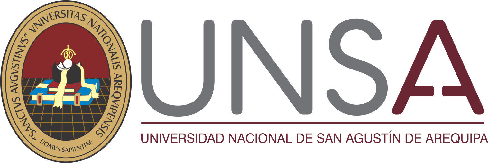

<div align="center">
<table>
    <thead>
        <tr>
            <td style="width:25%; text-align:center;"></td>
            <td style="text-align:center;">
                <span><b>UNIVERSIDAD NACIONAL DE SAN AGUSTIN</b></span><br />
                <span><b>FACULTAD DE INGENIERÍA DE PRODUCCIÓN Y SERVICIOS</b></span><br />
                <span><b>DEPARTAMENTO ACADÉMICO DE INGENIERÍA DE SISTEMAS E INFORMÁTICA</b></span><br />
                <span><b>ESCUELA PROFESIONAL DE INGENIERÍA DE SISTEMAS</b></span>
            </td>
            <td style="width:25%; text-align:center;"></td>
        </tr>
    </thead>
    <tbody>
        <tr>
            <td colspan="3"><span><b>Curso</b></span>: Sistemas Operativos</td>
        </tr>
        <tr>
            <td colspan="3"><span><b>Semestre:</b></span>: 2026 - B</td>
        </tr>
    </tbody>
</table>
</div>
<div align="center" style="margin-top: 10px;">
    
    <h1 style="font-weight:bold; font-size: 2em;">Curso completo de Sistemas Operativos</h1>
</div>

# Curso completo Sistemas Operativos

## Informes y entregables del curso

Este curso no cuenta con una carpeta de drive. Las tareas, prácticas y entregables se irán insertando en carpetas enlazadas dentro de este repositorio, y cada una se podrá consultar mediante el enlace indicado en el índice.

Repositorio principal: [Sistemas_Operativos](https://github.com/gcarrillov/Sistemas_Operativos)

## Índice

| Semana | Práctica / Tarea | Tema | Presentado en |
| :--- | :--- | :--- | :--- |
| Semana 6 | [descripcion concurrencia](#concurrencia) | Concurrencia y Threads | [Concurrencia](https://github.com/gcarrillov/Sistemas_Operativos/tree/7ddaef59b1b8a0acbc2bf45541262280760ab61e/Concurrencia) |

1. [Equipo y Recursos Varios](#equipo-y-recursos-varios)


# Prácticas y Tareas

### Concurrencia
Semana 6 · Unidad II · Capítulo III

Esta práctica estudia cómo varias ejecuciones comparten tiempo, memoria y recursos. Se provoca una condición de carrera con varios threads que actualizan un contador y transfieren unidades entre dos saldos compartidos, y luego se corrige y se mide. Entre los puntos principales se trabajó en:

- Provocar el fallo: dos y cuatro threads con pausas aleatorias entre lectura y escritura, repitiendo 100 veces y registrando las corridas que violan la suma total o los límites.

- Definir invariantes: contador igual al número de pasos, suma de saldos constante y saldos no negativos.

- Corrección: protección de la transición completa con un `Lock`, repitiendo las mismas pruebas.

- Medición: costo de la protección con y sin pausas.

- Atomicidad y visibilidad: explicación de lo obtenido con la exclusión mutua y la relación happens-before.

- Prueba automatizada: pruebas con `unittest` que fallan si algún invariante se rompe.

La carpeta incluye el código fuente, los resultados de las corridas, el informe en LaTeX y un README propio que explica cómo ejecutarlo.

**Para detallar en el desarrollo ingresar a [Concurrencia](https://github.com/gcarrillov/Sistemas_Operativos/tree/7ddaef59b1b8a0acbc2bf45541262280760ab61e/Concurrencia)**

### Próximas prácticas
Las siguientes tareas se agregarán como nuevas carpetas enlazadas en este mismo repositorio y se actualizará el índice.


# Equipo y Recursos Varios

En esta sección se presenta al integrante del curso junto con el enlace a su repositorio. Además, se incluyen recursos adicionales que complementan el trabajo realizado.

## Autor

- **Gustavo Alonso Carrillo Villalta** → [Este Repositorio](https://github.com/gcarrillov/Sistemas_Operativos.git)
```text
https://github.com/gcarrillov/Sistemas_Operativos.git
```

## Docente

- **MSc. Norman Patrick Harvey Arce**

## Recursos Complementarios

- Informes de cada práctica en LaTeX dentro de su carpeta
- Código fuente y resultados reproducibles de cada tarea